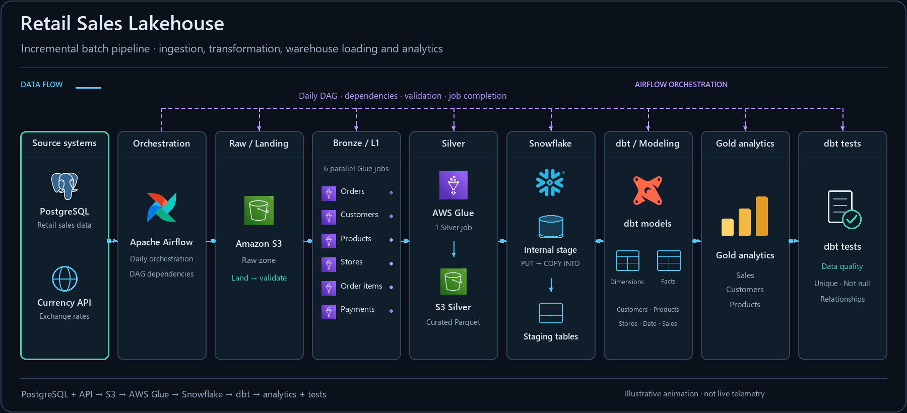
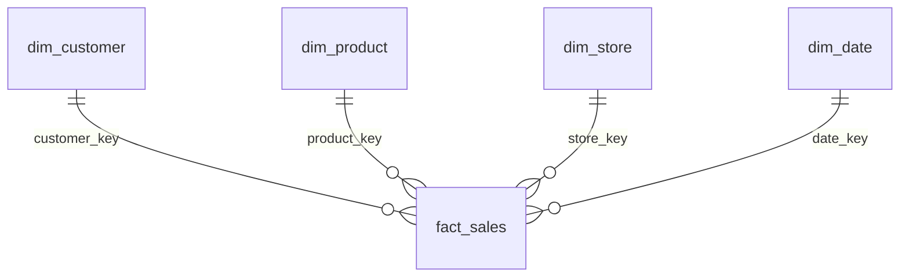

# Retail Sales Lakehouse

A daily retail pipeline using PostgreSQL, a Currency API, Airflow, S3, AWS Glue, Snowflake and dbt.



**Flow:** PostgreSQL + Currency API → Airflow → S3 Raw → six Bronze Glue jobs → Silver Glue job → S3 Parquet → Snowflake internal stage → staging tables → dbt dimensions, facts and Gold analytics → dbt tests.

## How to run it

This project needs AWS and Snowflake resources; Docker runs PostgreSQL, Airflow and dbt locally.

1. Clone this repository. In [docker/docker-compose.yml](docker/docker-compose.yml), replace the machine-specific AWS/dbt mounts and bucket name. Provide the listed `SNOWFLAKE_*` environment variables and a Snowflake dbt profile named in [dbt_project.yml](dbt/retail_sales_lakehouse/dbt_project.yml).
2. Start the source database, apply [source_system/schema.sql](source_system/schema.sql), and populate the retail tables. Also create an `etl_watermark` table with `pipeline_name`, `last_watermark` and `updated_at`, seeding an `orders_pipeline` row with your initial timestamp; this setup is not included in the source DDL.
3. Create the S3 bucket and seven Glue jobs using [glue/](glue/). Package `common.bronze` for the Bronze jobs. Configure `RAW_ROOT_PATH`, `BRONZE_ROOT_PATH`, `BATCH_DATE`, plus Silver's `SILVER_ROOT_PATH` and `REJECT_ROOT_PATH`. Use `raw` and `archive/l2` prefixes for raw and Silver data to match the loader. Grant AWS access and configure Airflow's AWS connection and `snowflake_default`.
4. Apply the setup SQL in [snowflake/sql/](snowflake/sql/) (database, schemas, warehouse, file format, stage and staging tables). Build and start Docker services from the repository root:

```bash
docker build -t retail-dbt docker/dbt
docker compose -f docker/docker-compose.yml up airflow-init
docker compose -f docker/docker-compose.yml up -d postgres airflow-scheduler airflow-webserver dbt
```

Open Airflow at `http://localhost:8080` (demo login: `admin/admin`) and trigger `daily_retail_pipeline`. Align the run's logical date, extraction date and Bronze job `BATCH_DATE`; the DAG passes `{{ ds }}` only to Silver and the warehouse loader. The final task runs `dbt deps && dbt run && dbt test`. To rerun modeling/tests separately:

```bash
docker exec retail-dbt bash -c "cd /usr/app/retail_sales_lakehouse && dbt run && dbt test"
```

## Idempotency: rerunning a batch date

- **Extraction:** [orders](airflow/plugins/extract_postgres.py) uses `order_date > last_watermark`; the other five tables are full extracts. The watermark advances to the maximum extracted order date immediately after local staging.
- **Lake:** raw uploads replace the same object keys; [Bronze](glue/common/bronze.py) and [Silver](glue/silver/silver_job.py) overwrite their `batch_date=YYYY-MM-DD` output paths. Silver reads across Bronze batches and keeps one row per entity ID using `row_number()`, ordered by descending `ingestion_timestamp`.
- **Warehouse:** the [loader](airflow/plugins/load_to_snowflake_stage.py) removes and replaces each batch's staged files. [COPY](airflow/dags/snowflake/sql/copy_into.sql) uses Snowflake load history without `FORCE`; it does not delete or merge existing batch rows. dbt rebuilds `fact_sales`, choosing the latest batch per order/order item.

These are overwrite and dedup safeguards, not an end-to-end exactly-once guarantee. For downstream retries, preserve the original batch inputs and rerun failed tasks; re-extraction after the watermark advances does not replay the original orders.

## Data model

One `fact_sales` row represents an order item. Measures include quantity, unit price/cost, discount, line total and profit.



See [core models](dbt/retail_sales_lakehouse/models/core/). Customer/product/store keys reuse source IDs; the date key is the order date. Gold marts aggregate sales, customer and product analytics.

## Data quality

| Check | Result / destination |
|---|---|
| Raw files missing, empty or malformed; missing required order columns | Validation task fails; missing orders batches may be skipped. |
| Duplicate entity IDs | Silver window dedup keeps the latest ingestion; timestamp ties have no deterministic tie-breaker. |
| Mandatory order fields or lineage fields are null | Rows are dropped; counts are logged, with no reject dataset. |
| Customer email fails the regex | Parquet at `REJECT_ROOT_PATH/customers`, with `reject_reason = "Invalid Email"`; overwritten each run. Null emails enter neither valid nor reject output. |
| dbt model checks | [schema.yml](dbt/retail_sales_lakehouse/models/core/schema.yml) tests dimension keys and `order_item_id` for uniqueness/non-nullness, plus customer/product/store fact relationships. Failures stop the final task; rows are not quarantined. |

## Screenshots

<details>
<summary>Expand execution and storage screenshots</summary>


</details>

## Limitations and trade-offs

- Watermarks use order time rather than update time: late/backdated orders and updates to older orders can be missed. Advancing before downstream success leaves a recovery gap.
- Extraction/landing use wall-clock dates while downstream tasks use Airflow's logical date. Historical backfills need manual alignment.
- Silver scans Bronze history; full extracts and table rebuilds favor simplicity over scale. The warehouse loader currently uploads only the first Parquet file per dataset, so multi-file outputs can lose rows.
- Reject history is overwritten, missing FX matches remain null, and fact inner joins can omit sales with missing dimensions. FX is enriched in Silver; fact amounts remain in source currency.
- FX API failures fall back to cached rates with a `DEGRADED` status. Cloud provisioning, sample data and credential/profile setup remain manual.
