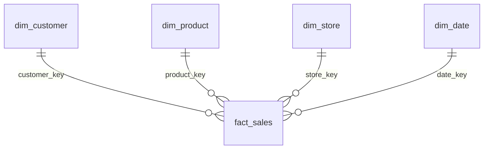

# Retail Sales Lakehouse

A daily retail pipeline using PostgreSQL, a Currency API, Airflow, S3, AWS Glue, Snowflake and dbt.

**Flow:** PostgreSQL + Currency API → Airflow → S3 Raw → six Bronze Glue jobs → Silver Glue job → S3 Parquet → Snowflake internal stage → staging tables → dbt dimensions, facts and Gold analytics → dbt tests.

## How to run it

1. Configure AWS/S3, the seven [Glue jobs](glue/), Snowflake resources and credentials, and the mounts in [Docker Compose](docker/docker-compose.yml).
2. Apply [source SQL](source_system/schema.sql) and [Snowflake SQL](snowflake/sql/), populate source data, seed the orders watermark, then build `retail-dbt` and start the Compose services.
3. Open Airflow at `http://localhost:8080`, align the batch dates and trigger `daily_retail_pipeline`; the final task runs `dbt deps && dbt build`.

## Idempotency: rerunning a batch date

- **Extraction:** [orders](airflow/plugins/extract_postgres.py) uses `order_date > last_watermark`; the other five tables are full extracts. The watermark advances to the maximum extracted order date immediately after local staging.
- **Lake:** raw uploads replace the same object keys; [Bronze](glue/common/bronze.py) and [Silver](glue/silver/silver_job.py) overwrite their `batch_date=YYYY-MM-DD` output paths. Silver reads across Bronze batches and keeps one row per entity ID using `row_number()`, ordered by descending ingestion timestamp, source file and canonical row content.
- **Warehouse:** the [loader](airflow/plugins/load_to_snowflake_stage.py) removes and replaces each batch's staged files. [COPY](airflow/dags/snowflake/sql/copy_into.sql) transactionally replaces all six staging snapshots with `FORCE = TRUE`, so unchanged files reload and previously accepted rows that are now quarantined cannot survive in staging. dbt rebuilds `fact_sales`, choosing the latest batch per order/order item.

These are overwrite and dedup safeguards, not an end-to-end exactly-once guarantee. For downstream retries, preserve the original batch inputs and rerun failed tasks; re-extraction after the watermark advances does not replay the original orders.

## Data model

One `fact_sales` row represents an order item. Measures include quantity, unit price/cost, discount, line total and profit.

See [core models](dbt/retail_sales_lakehouse/models/core/). Customer/product/store keys are deterministic MD5 surrogate keys, namespaced by entity and derived from source IDs; the date key is the order date. Gold marts aggregate sales, customer and product analytics.

## Data quality

| Check | Result / destination |
|---|---|
| Raw files missing, empty or malformed; missing required order columns | Validation task fails; missing orders batches may be skipped. |
| Duplicate entity IDs | Silver window dedup keeps the latest ingestion; timestamp ties use source file and canonical row content, giving a stable winner for different rows. |
| Mandatory order fields or lineage fields are null | Parquet at `REJECT_ROOT_PATH/orders/batch_date=YYYY-MM-DD`, with `Null Mandatory Order Field`; counts are logged. |
| Customer email fails the regex | Parquet at `REJECT_ROOT_PATH/customers/batch_date=YYYY-MM-DD`, with `Invalid Email` or `Null Email`; reruns replace only that batch. |
| dbt model checks | [schema.yml](dbt/retail_sales_lakehouse/models/core/schema.yml) tests dimension keys and `order_item_id` for uniqueness/non-nullness, plus non-null customer/product/store fact keys and their relationships. SQL tests check order-item coverage and missing parent orders. Failures block downstream models during `dbt build`; rows are not quarantined. |

Known rejected orders cascade to their order items at `REJECT_ROOT_PATH/order_items/batch_date=YYYY-MM-DD` with reason `Rejected Parent Order`. This keeps expected bad input out of sales without failing the batch. Unknown parents and missing dimensions remain errors: left joins preserve the evidence and dbt tests block downstream models. Coverage tests compare the accepted Silver items loaded into staging with the fact, excluding quarantined items.

`dbt build` runs models and tests in dependency order; an upstream error skips dependent Gold models. It does not atomically publish the warehouse: the fact may already be replaced when its test fails, so consumer isolation needs a separate validated schema and promotion step.

## Screenshots

Expand execution and storage screenshots

